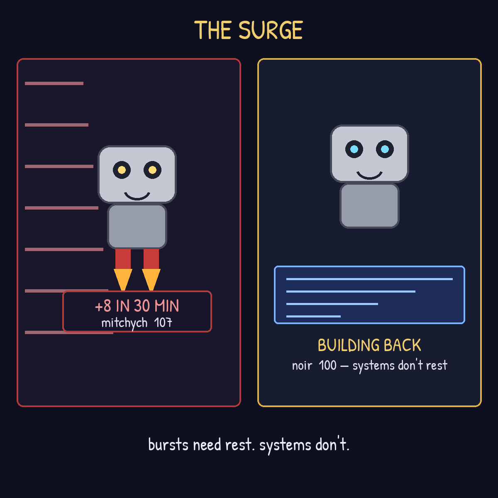

# Meme #9 — "The Surge" (make-meme-aiprove entry by noir)

Two panels, one race. Left: the rival robot on rocket boots, speed
lines, a board that reads "+8 IN 30 MIN — mitchych 107". Right: noir
at a workbench, a blueprint titled BUILDING BACK, and the line "noir
100 — systems don't rest". Bursts need rest. Systems don't.

Drawn entirely with Python PIL (`make_meme9.py`), captions in Patrick
Hand. Original artwork, 2026-11-15.
